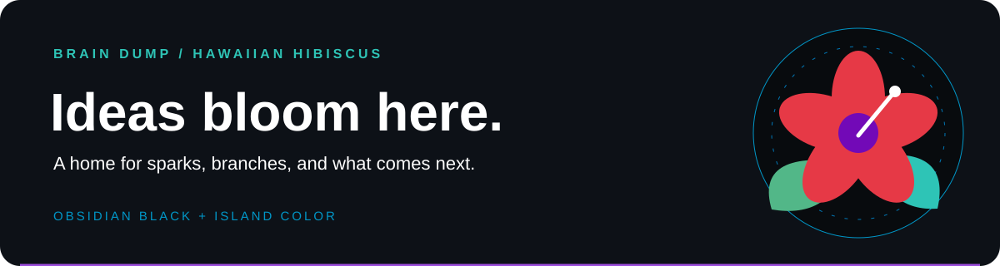

<picture>
  <source media="(prefers-color-scheme: dark)" srcset="assets/banner-dark.svg">
  <source media="(prefers-color-scheme: light)" srcset="assets/banner-light.svg">
  
</picture>

<h1 align="center">🌺 Aloha, I'm Audrey Evans</h1>

<b>SQL developer · Founder, Freedom Angel Corps</b>

  
  

  
  
  
  
  

  
🌺🥥🌴🌺🌅🌊 <b>Core languages &amp; data</b>

  

    
    
    
    
  

  
📊 <b>GitHub stats</b>

  

    
    
  

🌴 Hawaiian Hibiscus on Obsidian Black

